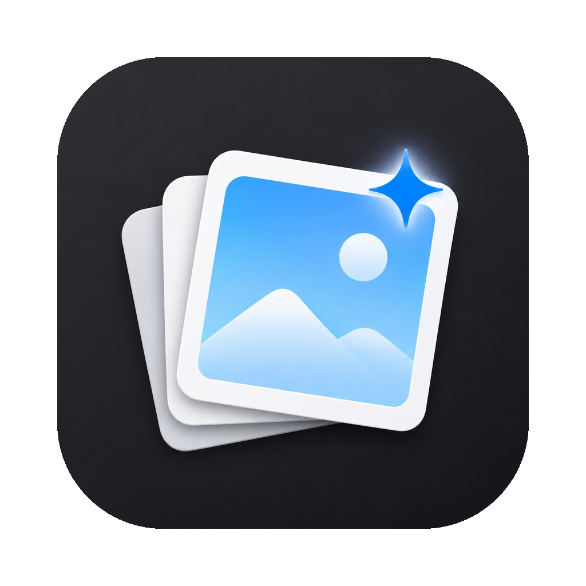
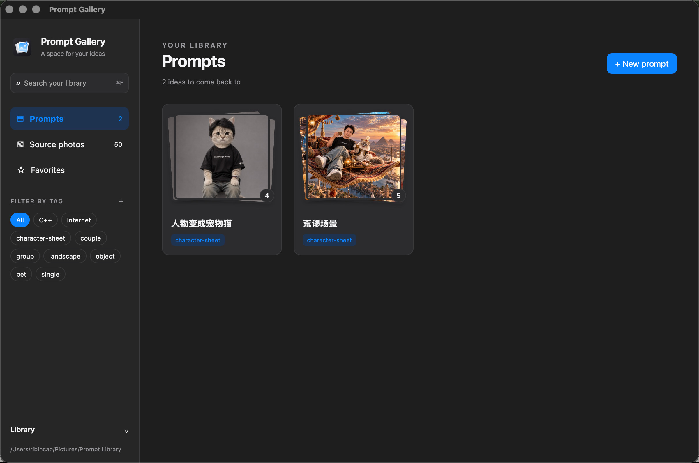
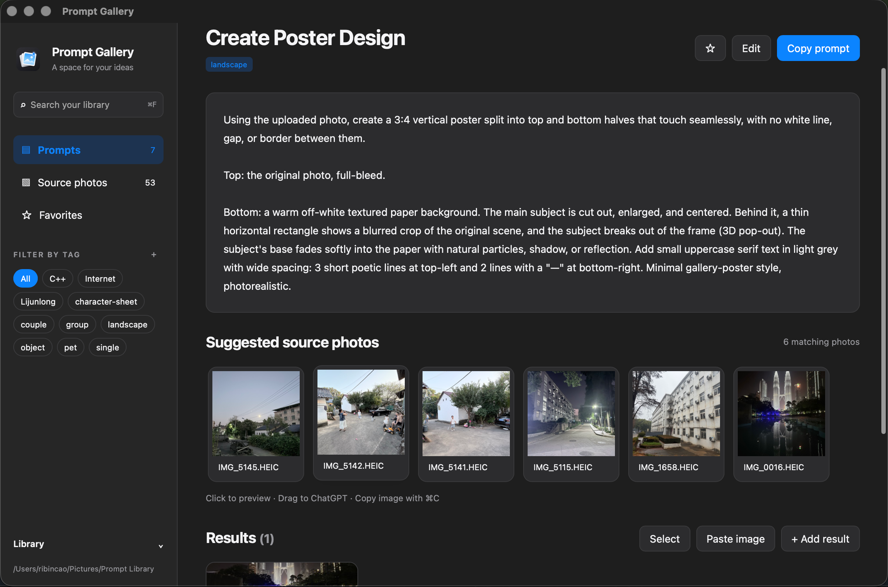
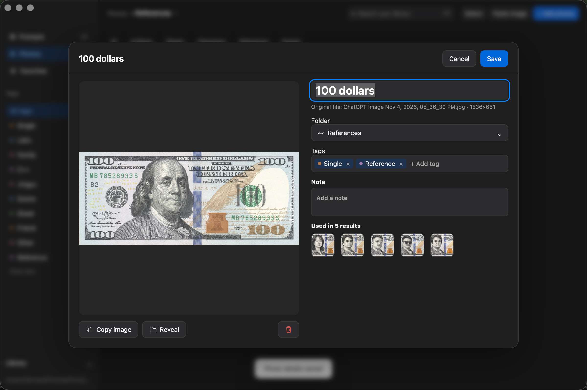

<p align="center">
  
</p>

<h1 align="center">Prompt Gallery</h1>

<p align="center">
  A local Mac app for the AI image prompts you collect, the photos you feed them,<br>
  and the pictures they make.
</p>



## Why

You find a great image prompt online, try it in ChatGPT, and rename the chat so you can find
it again. A few dozen prompts later, nothing is findable. Every new test also means digging
through your photo library for the right kind of picture: a solo portrait, a group shot, your
cat, a landscape, a character sheet.

Prompt Gallery keeps all three things together and linked:

- **Prompts**: the text, where you found it, and what kind of source photo it needs.
- **Source photos**: your own pictures, tagged by what they show.
- **Results**: every image a prompt produced, with the source photo it used and a link back
  to the ChatGPT conversation.

Open a prompt and the matching source photos are right there. Copy the prompt, drag a photo
into ChatGPT, and paste the result back in.



### Copy a photo, paste it into ChatGPT

No more hunting for the original file in Finder or Photos. Open any source photo, click
**Copy image** (or select it and press ⌘C), then press ⌘V in ChatGPT. The app puts the original
file on the clipboard, so ChatGPT gets the full-quality photo, HEIC included. Prefer dragging?
Drag the thumbnail straight into the chat instead.



## Features

- **Prompt grid with stacked results.** Each card shows a prompt's newest results as a little
  pile of photos with a count.
- **One-click Copy prompt.**
- **Suggested source photos.** A prompt says what it needs (`single`, `couple`, `group`, `pet`,
  `landscape`, `character-sheet`, `object`, or your own tags); the app shows photos tagged with
  any of them.
- **Copy and paste a photo into ChatGPT** with one click (or ⌘C), or drag it straight into the
  chat. No digging for the original file; you always send the original, and nothing is exported.
- **Add results fast**: paste a copied image with ⌘V, drop files onto a prompt card, or pick
  them. A ChatGPT link on your clipboard is filled in automatically.
- **Link results to source photos** by clicking thumbnails, one result or many at once.
- **Search and filter** by title, prompt text, tags and notes; mark favorites.
- **Light and dark mode**, following the system.

## Your data stays yours

Everything lives in a **library folder you choose** on first launch, for example
`~/Pictures/Prompt Library`. It is never inside this repo, so the repo holds only the app and
anyone can use it for their own collection. Nothing is uploaded and there are no accounts.

The library is plain files you can open without the app:

```
Prompt Library/
  library.json          marks the folder as a library, holds your tag list
  sources/              your photos (copied in unchanged) + one .json each
  prompts/<id>/
    prompt.md           the prompt text, exactly as written
    meta.json           title, needs, tags, notes, source link
    results/            generated images + one .json each
  .thumbs/              thumbnails, safe to delete (rebuilt automatically)
```

Safety rules the app follows:

- **Importing always copies.** Your original files are never moved or changed.
- **Deleting moves to the macOS Trash**, so you can put things back from Finder.
- **Saves are atomic**: a crash can't leave a half-written file.
- **It never writes outside the library folder** (apart from its own small config file), and
  it can only display images from inside the current library.

The library is a normal folder, so back it up like one. Time Machine covers it. iCloud Drive is
*not* a backup: deletions sync everywhere, and "Optimize Mac Storage" can remove originals.

## Install and run (macOS)

There's no signed download yet; you build it yourself. You need:

- macOS with the Xcode Command Line Tools (`xcode-select --install`)
- [Rust](https://rustup.rs)
- Tauri CLI 2: `cargo install tauri-cli --version '^2'`

No Node.js is needed. The interface is plain HTML, CSS and JavaScript with no build step.

```bash
git clone https://github.com/ribincao/prompt-gallery.git
cd prompt-gallery
make build    # builds src-tauri/target/release/bundle/macos/Prompt Gallery.app
```

Drag `Prompt Gallery.app` into `/Applications`. Because the build isn't signed, macOS may block
the first launch: right-click the app, choose **Open**, then **Open** again.

Other commands:

```bash
make dev                     # run in development mode with live reload of the UI
make icon SRC=app-icon.png   # regenerate the icon set from a 1024×1024 PNG
make clean                   # remove build output
```

## How to use it

1. **Choose a library folder** on first launch. An empty folder (or a new one) works best.
   Switch later from **Library** at the bottom of the sidebar.
2. **Add source photos.** Go to *Source photos* and drop, paste or pick images, then tag them
   by what they show. A photo can have several tags. Open a photo and edit **Name** to rename
   its display label; results have the same field under **Edit**. Names are trimmed and limited
   to 200 characters. Clear the field to restore the original filename (sources) or date
   (results). Renaming changes metadata only; files and links keep their IDs.
3. **Create a prompt** with **+ New prompt** (⌘N). Paste the text, give it a title, and choose
   which kinds of photo it needs. Pasting a long block of text into an empty prompt grid starts
   a new prompt for you.
4. **Try it.** Open the prompt, click **Copy prompt**, and send one of the suggested photos to
   ChatGPT: drag it into the chat, or select it, press ⌘C and paste there.
5. **Save the results.** Copy the generated image in ChatGPT and press ⌘V in the prompt, or drop
   the files onto the prompt card. Click the source photos you used and keep the chat link.
6. **Manage tags.** Click **＋** beside **FILTER BY TAG** to open **Manage tags**. Add a
   tag, rename it, or remove it from the vocabulary and every photo and prompt. Renaming
   to an existing name merges the tags. Inline confirmations explain removal and merging;
   photos, prompts and results are kept. Each row shows how many photos and prompts use it.
7. **Come back later.** Search, filter by tag, open a result full size, and use **Open chat** to
   jump back into the conversation.

| Shortcut | Does |
|---|---|
| ⌘N | New prompt |
| ⌘Enter | Submit the open form |
| ⌘F | Search |
| ⌘V | Paste an image into the current view |
| ⌘C | Copy the selected source photo |
| ← → | Step through results in the full-size view |
| Esc | Close a dialog or the full-size view |

Form dialogs keep **Cancel** and the primary action beside the title, with errors just
below. Enter in a single-line field submits; Esc cancels. Long content scrolls beneath the
header; long prompt text and tag-manager lists have their own scroll area.

Tag operations save each changed record atomically, but the whole operation is not a
transaction. If a write fails, the app reports how many records were already updated and
refreshes the library. Unreadable records are skipped with warnings; repair them before
retrying if you need those records included.

## Use it from an AI agent

Prompt Gallery and `pgallery` are macOS-only. Install the Claude Code plugin:

```text
/plugin marketplace add ribincao/prompt-gallery
/plugin install prompt-gallery@prompt-gallery
```

Install the Codex plugin:

```sh
codex plugin marketplace add ribincao/prompt-gallery
codex plugin add prompt-gallery@prompt-gallery
```

Both plugins use the same skill folder. As a manual fallback, copy `skills/prompt-gallery` into `~/.claude/skills/` or `~/.agents/skills/`.
The skill offers to save images after generation and uses the shared storage CLI:

```sh
make install-cli
pgallery add --prompt-file /tmp/prompt.txt --result /tmp/generated.png --model "image-tool" --tags portrait --json
```

Open the app once to choose a library, or pass `--library <folder>`. An empty existing
folder is initialized on the first add. The open app refreshes automatically.
See [agent integration](docs/agent-integration.md) for the CLI reference and config paths.

## Windows

**Prompt Gallery runs on macOS only for now.** It's built on [Tauri](https://tauri.app), which
supports Windows, so a port is realistic, but a few features call macOS directly:

| Feature | macOS implementation | What Windows would need |
|---|---|---|
| Thumbnails | the built-in `sips` tool | an image library such as the `image` crate |
| Reveal in Finder | `open -R` | `explorer /select,<path>` |
| Copy image (file + pixels) | AppKit pasteboard (`native.rs`) | the Win32 clipboard (`CF_HDROP` + bitmap) |
| Move to Trash | the `trash` crate | already cross-platform (Recycle Bin) |

With those swapped in, it would build on Windows with the same `cargo tauri build`, plus the
[Tauri Windows prerequisites](https://tauri.app/start/prerequisites/) (Microsoft C++ Build
Tools and WebView2). Pull requests are welcome.

## How it's built

- **`src/`**: the interface. Plain HTML, CSS and JavaScript, no framework and no network
  requests.
- **`src-tauri/`**: the Rust side, which does all file work through a small set of commands:
  - `library.rs`: storage, imports, thumbnails, Trash.
  - `commands.rs`: the commands the interface calls.
  - `asset.rs`: serves images, only from the current library.
  - `native.rs`: the macOS clipboard.
- **`docs/spec.md`**: the full design: data format, screens and safety rules.

Run the checks:

```bash
cd src-tauri && cargo test && cargo build
```

The interface tests in `tests/` use jsdom and Playwright; see the comment at the top of each
file for how to run them.

## License

[MIT](LICENSE)
